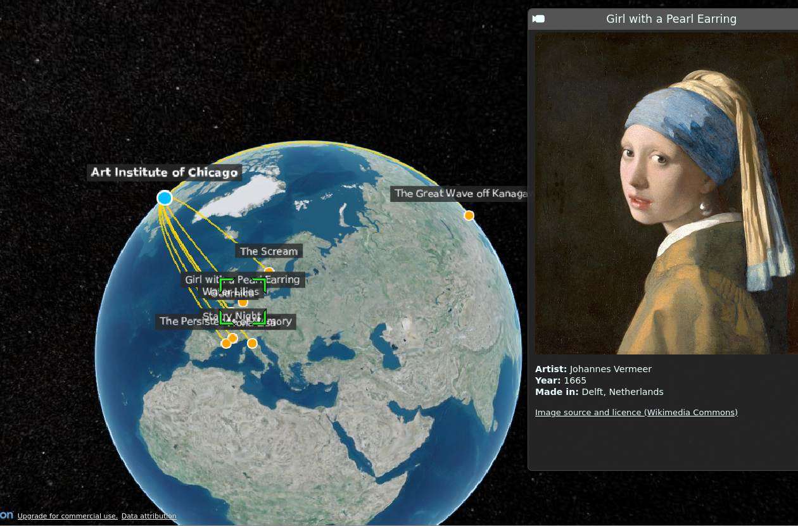

# Example: Where Are the Artworks From?



Students create an artworks table in Supabase. Each row is one artwork, with the place it was made and the museum that holds it.

1. Create the table and sample data. Run this in the Supabase SQL Editor:

```
-- Create the table
create table artworks (
  id bigint generated always as identity primary key,
  title text,
  artist text,
  year text,
  place_name text,
  latitude double precision,
  longitude double precision
);

-- Allow anyone with the anon key to read it
alter table artworks enable row level security;
create policy "Anyone can read artworks"
on artworks for select
using (true);

-- Add sample rows
insert into artworks (title, artist, year, place_name, latitude, longitude) values
('The Great Wave off Kanagawa', 'Katsushika Hokusai', '1831', 'Edo (Tokyo), Japan', 35.68, 139.69),
('Girl with a Pearl Earring', 'Johannes Vermeer', '1665', 'Delft, Netherlands', 52.01, 4.36),
('Starry Night', 'Vincent van Gogh', '1889', 'Saint-Rémy-de-Provence, France', 43.79, 4.83),
('The Persistence of Memory', 'Salvador Dalí', '1931', 'Port Lligat, Spain', 42.29, 3.28),
('Mona Lisa', 'Leonardo da Vinci', 'c. 1503', 'Florence, Italy', 43.77, 11.25),
('Water Lilies', 'Claude Monet', '1919', 'Giverny, France', 49.08, 1.53),
('The Scream', 'Edvard Munch', '1893', 'Oslo, Norway', 59.91, 10.75),
('Guernica', 'Pablo Picasso', '1937', 'Paris, France', 48.86, 2.35);
```

2. For the examples to work you need a Cesium access token and Supabase publishable key.

3. Wikidata SPARQL Query. Go to query.wikidata.org and run this query to show the first random 20 paintings from the Art Institute of Chicago collection.

```
SELECT ?painting ?paintingLabel ?image WHERE {
  ?painting wdt:P195 wd:Q239303;   # collection: Art Institute of Chicago
            wdt:P31 wd:Q3305213;   # instance of: painting
            wdt:P18 ?image.        # has an image
  SERVICE wikibase:label { bd:serviceParam wikibase:language "en". }
}
LIMIT 20
```

4. You can also display maps on the Wikidata Query Service.

```
#defaultView:Map
# Paintings held by the Art Institute of Chicago, with a picture and the place they were made
SELECT ?painting ?paintingLabel ?image ?placeLabel ?coord WHERE {
  ?painting wdt:P195 wd:Q239303;   # collection: Art Institute of Chicago
            wdt:P31 wd:Q3305213;   # instance of: painting
            wdt:P18 ?image;        # has an image
            wdt:P1071 ?place.      # place of creation
  ?place wdt:P625 ?coord.          # coordinates of that place
  SERVICE wikibase:label { bd:serviceParam wikibase:language "en". }
}
LIMIT 50
```

Tip: change `#defaultView:Map` to `#defaultView>Table` to see where the data that is being retrieved.